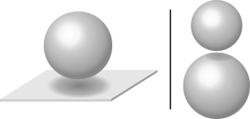

# caspwn

`caspwn` is a Python package for computing **Casimir and van der Waals forces** involving **spherical geometries**.  
The package implements the **scattering formalism** using a **plane-wave representation** of electromagnetic modes combined with **Nyström discretization**, enabling precise and efficient numerical evaluations.  
Currently, the **plane–sphere** and **sphere–sphere** configurations are supported, as illustrated below.

### Features
- Covers a broad range of separations, sphere radii, and temperatures relevant to modern Casimir-force experiments.  
- Supports commonly used material models such as the **Drude** and **plasma** models for metals, as well as **arbitrary dielectric functions**.  
- Allows for **arbitrary dielectric media** between interacting surfaces.  
- Provides a simple interface for **user-defined materials**.  
- Includes **accelerated Matsubara-frequency summation** through **Padé spectrum decomposition** for improved convergence and reduced runtime.

<p align="center">
  
</p>

---

## Installation
In order to install `caspwn`, first navigate to package folder
```
cd path/to/caspwn
```

We recommend creating a virtual environment with either of the two 
### Method 1: Using Conda (Anaconda/Miniconda)

1. Create a new Conda environment with the required packages:

```bash
conda create --name myenv python=3.11 --file requirements.txt
```

2. Activate the Conda environment:
```bash
conda activate myenv
```


### Method 2: Using `venv`

1. Create a virtual environment:
    ```bash
    python -m venv myenv
    ```

2. Activate the virtual environment:

    - **On macOS/Linux**:
      ```bash
      source myenv/bin/activate
      ```

    - **On Windows**:
      ```bash
      myenv\Scripts\activate
      ```

### Installing caspwn

Once your virtual environment is set up (using either Conda or `venv`),
you can install `caspwn` using pip:

```bash
pip install .
```

### Verifying the installation

To ensure the installation was successful, you can run the test suite using pytest by executing the following command
from the root of the `caspwn` directory:

```bash
pytest tests/
```
This will run all unit and functional tests in the `tests/` folder and verify that the package is functioning as expected.
Please note that running the tests may take several minutes depending on the complexity and size of the test suite.
For a quick check, the slow tests can be skipped:

```bash
pytest tests/ -m quick
```

If all tests pass, the installation is verified.

---

## Getting started

### Example 1 (sphere-sphere geometry)

We calculate the Casimir force between two spheres of radius R1=10um and R2=20um at a separation of 1um at room temperature (T=300K).
The spheres are assumed to be perfect reflecting (material=PEC) and immersed in vacuum.

First we import the `sphere_sphere_system` class and the materials of the spheres and the dielectric medium:
```
from caspwn import sphere_sphere_system
from caspwn.materials import PEC, vacuum
```
We can then create a `sphere_sphere_system` instance corresponding to the geometry we are interested in:
```
s = sphere_sphere_system(T=300., L=1.e-6, R1=10.e-6, R2=20.e-6, mat_sphere1=PEC, mat_sphere2=PEC, mat_medium=vacuum)
```
Calling the `calculate` method with the desired observable as an argument then yields the result for the Casimir force
in units of Newton:
```
print(s.calculate('force'))
>>> -1.632226192726807e-14
```
The resulting Casimir force is attractive (negative sign) and about 16.3fN in magnitude. 

### Example 2 (plane-sphere geometry)

We calculate the Casimir force gradient (which is commonly measured in experiments using an AFM) between a sphere of
radius 50um and a plane at a separation of 100nm at room temperature (T=300K).
The sphere and plane are assumed to be gold (modeled by a simple Drude model with a plasma frequency of 9eV and a
dissipation constant of 35meV). The medium is vacuum.

The calculation is similar to the one presented in Example 1. We instead define the `plane_sphere_system` and calculate
the force gradient:
```
from caspwn import plane_sphere_system
from caspwn.materials import gold_drude as gold, vacuum
s = plane_sphere_system(T=300., L=100.e-9, R=50.e-6, mat_plane=gold, mat_sphere=gold, mat_medium=vacuum)
s.calculate('forcegradient')
>>> 0.0017678242955927433
```
The resulting Casimir force gradient is about 1.77mN/m.

## Usage

### Units and conventions

All input quantities are in SI units (temperature in K, lengths in m). `calculate` returns the Casimir free energy in J,
the force in N or the force gradient in N/m. A negative force is attractive.

For `T > 0` the free energy is given by the sum over Matsubara frequencies. After a call of `calculate`, the attribute
`result` holds the array `[energy, force, forcegradient]`, where only the requested observable and the ones before it
are computed (e.g. `'force'` computes energy and force). For `T = 0` the frequency integral is computed by numerical
integration and only the requested observable is returned.

### Options of `calculate`

| argument | meaning |
|---|---|
| `observable` | `'energy'`, `'force'` or `'forcegradient'` |
| `ht_limit` | if `True`, only the zero-frequency contribution (high-temperature limit) is computed |
| `etaN`, `etaM`, `etalmax` | discretization parameters, the radial and angular discretization orders and the multipole cut-off scale as `eta*sqrt(R/L)` and `eta*R/L` (with `R/L` at least 50); the sphere-sphere geometry uses `etaNin`, `etaNout`, `etaM`, `etalmax1`, `etalmax2` |
| `N`, `M`, `lmax` | set the discretization orders directly instead (sphere-sphere: `Nin`, `Nout`, `M`, `lmax1`, `lmax2`) |
| `fs` | Matsubara frequency summation, `'psd'` (Padé spectrum decomposition, default) or `'msd'` (plain Matsubara sum) |
| `epsrel` | relative accuracy of the frequency summation |
| `O` | order of the Padé spectrum decomposition (determined from `epsrel` if not given) |
| `cores` | number of threads used for the computation of the matrix elements |
| `debug` | print intermediate results and timings for each frequency |
| `sparse` | use sparse round-trip matrices, see below |

### Sparse round-trip matrices

For large aspect ratios R/L most elements of the round-trip matrices vanish. For R/L of at least
`plane_sphere_system.sparse_threshold` (default 100) the round-trip matrices are therefore stored and decomposed
in a sparse (envelope) format. This can be enforced or switched off with the `sparse` argument, e.g.
`s.calculate('forcegradient', sparse=False)`.
The `sphere_sphere_system` supports the same `sparse` argument. There, the sparse path is not faster than the dense
one for (R1+R2)/L up to a few thousand and is therefore switched off by default.

### Layered planes

The plane can consist of up to four materials. The material `mat_plane` forms the top layer facing the sphere, the
further materials follow below and the last one is the substrate. For example, a 50nm gold film on silica:
```
from caspwn import plane_sphere_system
from caspwn.materials import gold_drude as gold, silica, vacuum
s = plane_sphere_system(T=300., L=100.e-9, R=50.e-6, mat_plane=gold, mat_sphere=gold, mat_medium=vacuum)
s.add_plane_layers([silica], [50.e-9])
s.calculate('force')
```

### User-defined materials

A material is any object (or module) with the attributes
- `materialclass`: one of `'dielectric'`, `'drude'`, `'plasma'` or `'PEC'`, which determines the zero-frequency
  contribution,
- `epsilon(xi)`: the permittivity at the imaginary angular frequency `xi` in rad/s.

Drude materials additionally need the plasma frequency `wp` and the damping `gamma` (both in rad/s), plasma materials
need `wp` and `K_plasma = wp/c`. See the modules in `caspwn/materials/` (e.g. `gold_drude.py` or `silica.py`) for
examples.

## Documentation (wip)

The documentation contains more information about the classes and functions defined in this package.
It can be built using [sphinx](https://www.sphinx-doc.org/en/master/).
First navigate to the documentation folder
```
cd docs/
```
and execute the command
```
make html
```
to build the documentation. The html files can be found in the folder `docs/build/html` and they can be viewed with any standard web browser.


## Publications using caspwn

* [Plane-wave approach to the exact van der Waals interaction between colloid particles](http://aip.scitation.org/doi/10.1063/5.0011368)\
  Benjamin Spreng, Paulo A. Maia Neto, Gert-Ludwig Ingold, The Journal of Chemical Physics **153**, 024115 (2020). DOI:10.1063/5.0011368 [arXiv:2004.11889](https://arxiv.org/abs/2004.11889)

* [Measurement of the Casimir Force between 0.2 and 8 μm: Experimental Procedures and Comparison with Theory](https://www.mdpi.com/2218-1997/7/4/93)\
  Guiseppe Bimonte, Benjamin Spreng, Paulo A. Maia Neto, Gert-Ludwig Ingold, Galina L. Klimchitskaya, Vladimir M. Mostepanenko, Ricardo S. Decca, Universe **7**, 93 (2021). DOI:10.3390/universe7040093 [arXiv:2104.03857](https://arxiv.org/abs/2104.03857)

* [Casimir Interaction between a Plane and a Sphere: Correction to the Proximity-Force Approximation at Intermediate Temperatures](https://www.mdpi.com/2218-1997/7/5/129)\
  Vinicius Henning, Benjamin Spreng, Paulo A. Maia Neto, Gert-Ludwig Ingold, Universe **7**, 129 (2021). DOI:10.3390/universe7050129 [arXiv:2103.13927](https://arxiv.org/abs/2103.13927)

* [The Casimir Interaction between Spheres Immersed in Electrolytes](https://www.mdpi.com/2218-1997/7/5/156)\
  Renan O. Nunes, Benjamin Spreng, Reinaldo de Melo e Souza, Gert-Ludwig Ingold, Paulo A. Maia Neto, Felipe S. S. Rosa, Universe **7**, 156 (2021). DOI:10.3390/universe7050156

* [Probing the screening of the Casimir interaction with optical tweezers](https://link.aps.org/doi/10.1103/PhysRevResearch.3.033037)\
  Luis B. Pires, Diney S. Ether, Benjamin Spreng, *et al.*, Physical Review Research **3**, 033037 (2021). DOI:10.1103/PhysRevResearch.3.033037 [arXiv:2104.00157](https://arxiv.org/abs/2104.00157)

* [Casimir effect between spherical objects: Proximity-force approximation and beyond using plane waves](https://www.worldscientific.com/doi/10.1142/S0217751X22410093)\
  Tanja Schoger, Benjamin Spreng, Gert-Ludwig Ingold, Paulo A. Maia Neto, International Journal of Modern Physics A **37**, 2241009 (2022). DOI:10.1142/S0217751X22410093 [arXiv:2205.10819](https://arxiv.org/abs/2205.10819)

* [Universal Casimir Interaction between Two Dielectric Spheres in Salted Water](https://link.aps.org/doi/10.1103/PhysRevLett.128.230602)\
  Tanja Schoger, Benjamin Spreng, Gert-Ludwig Ingold, Paulo A. Maia Neto, Serge Reynaud, Physical Review Letters **128**, 230602 (2022). DOI:10.1103/PhysRevLett.128.230602 [arXiv:2112.08800](https://arxiv.org/abs/2112.08800)

* [Universal Casimir interactions in the sphere–sphere geometry](https://www.worldscientific.com/doi/10.1142/S0217751X22410056)\
  Tanja Schoger, Benjamin Spreng, Gert-Ludwig Ingold, Astrid Lambrecht, Paulo A. Maia Neto, Serge Reynaud, International Journal of Modern Physics A **37**, 2241005 (2022). DOI:10.1142/S0217751X22410056 [arXiv:2205.10812](https://arxiv.org/abs/2205.10812)

